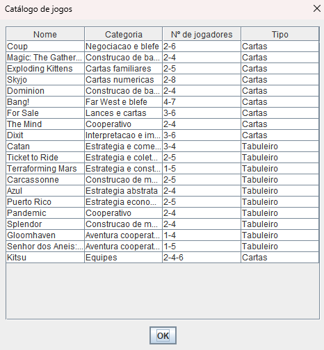
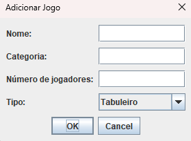

# Biblioteca de Jogos

Aplicação desktop simples em Java para gerenciar uma biblioteca de jogos de tabuleiro e cartas.

Os registros são armazenados no arquivo `board_games.csv`.

## Funcionalidades

- Adicionar jogos
- Visualizar o catálogo
- Atualizar jogos
- Remover jogos

## Pré-requisitos

- Java Development Kit (JDK) 8 ou superior

## Como executar

No terminal, dentro da pasta do projeto:

```bash
javac CRUD.java
java CRUD
```

A aplicação abre uma interface gráfica com opções para gerenciar o catálogo.

## Capturas de tela

### Tela principal


### Catálogo de jogos



### Adicionar jogo



### Atualizar jogo


### Remover jogo


## Formato dos dados

Os jogos são armazenados em CSV, com os seguintes campos:

```text
Nome,Categoria,Número de jogadores,Tipo
```

O campo `Tipo` pode ser `Tabuleiro` ou `Cartas`.
